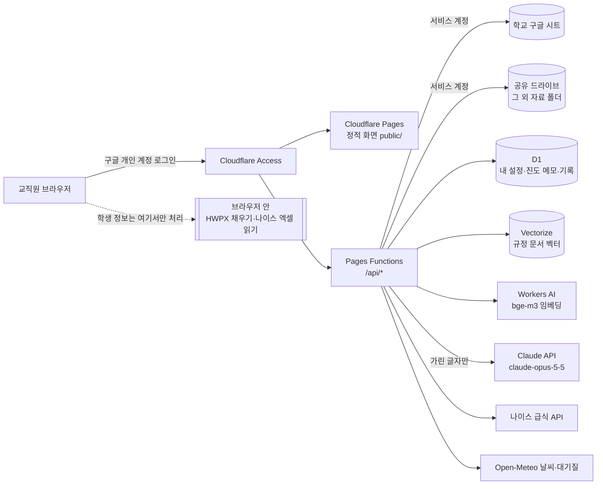

# 구조와 데이터 흐름, 보안 정책

## 한눈에

| 층 | 무엇 | 파일 |
|---|---|---|
| 화면 | 정적 HTML·CSS·ES 모듈. 빌드 과정 없음 | `public/` |
| 공용 계산 | 시간표·학사일정·차시·교체 후보·HWPX 채우기·개인정보 가림. 브라우저·서버·테스트가 같은 코드를 씀 | `public/js/lib/` |
| API | 로그인 확인, 시트 읽기/쓰기, AI 호출 | `functions/api/` |
| 서버 공통 | Access JWT 검증, 구글 서명, 시트 → 모델 변환, 역할 | `functions/_lib/` |
| 저장소 | D1 표 구조 | `migrations/` |
| 카드 설정 | 바로가기 링크·학기 날짜 | `public/config/dashboard.json` |

## 데이터는 어디에 두나

| 데이터 | 자주 바뀜? | 누가 고침 | 어디에 |
|---|---|---|---|
| 교직원 명단·역할 | 가끔 | 정보 담당 | 구글 시트 `권한` |
| 전체 시간표 | 학기마다·수시 | 시간표 담당 | 구글 시트 `전체시간표` |
| 학사일정(수업 없는 교시) | 수시 | 교무기획부 | 구글 시트 `학사일정` |
| 당번표·월중계획·관리자 일정 | 매주 | 교무부장·각 부서 | 구글 시트 각 탭 |
| 업무분장 | 학기마다·수시 | 교무기획부 | 구글 시트 `업무분장` |
| 대강·교체 기록 | 매일 | 교사 신청 → 수업계 확정 | 구글 시트 `대강교체` (화면에서 자동 기록) |
| 그 외 자료 | 수시 | 교원 누구나 | 공유 드라이브 폴더 + 시트 `그외자료` 목록 |
| 카드 링크·학기 날짜 | 학기마다 | 정보 담당 | `dashboard.json` (GitHub) |
| 내 설정·진도 메모 | 수시 | 교사 본인 | D1 (`prefs`, `plan_notes`) |
| 내 메모(스티키 노트) | 수시 | 교사 본인 | D1 (`notes`), 모든 쿼리에 본인 메일 조건 |
| 규정 챗봇 문서 | 가끔 | 정보 담당·관리자 | D1 원문 조각 + Vectorize 벡터 |
| **학생 정보** (이름·번호·출결) | — | 담임 | **저장하지 않음.** 브라우저 메모리에서만 |

시트는 Functions가 한 번에 읽어 60초 동안 재사용합니다(`functions/_lib/store.js`). 화면에서 쓰기를 하면 바로 새로 읽습니다.

## 요청 흐름

1. **로그인**: Cloudflare Access가 구글 로그인을 받고, 요청에 서명된 JWT(`Cf-Access-Jwt-Assertion`)를 붙입니다.
2. **API 공통 미들웨어** (`functions/api/_middleware.js`)
   - JWT 서명·aud·iss·만료를 Access 공개키로 다시 검증합니다.
   - 이메일로 `권한` 탭을 찾아 이름·역할을 붙입니다. 없으면 403을 돌려줍니다.
   - 다른 출처에서 온 쓰기 요청(POST/PUT/DELETE)을 막습니다.
3. **첫 화면** `GET /api/bootstrap`: 내 정보·권한, 전체 시간표, 학사일정, 이번 달 월중계획, 이번 주 관리자 일정을 보냅니다. 당번표와 메일 주소는 보내지 않습니다.
4. **역할별 API**
   - `/api/morning`: 교무부장만 받습니다.
   - `/api/subs/status` 확정·반려: 수업계·교무부장·관리자만 할 수 있습니다.
   - `/api/admin/docs`: 정보 담당·관리자만 쓸 수 있습니다.

## 화면 기능별 흐름

### 수업 변경 신청
1. 복무 시작·끝 시각(24시)과 겹치는 내 수업만 결강으로 잡습니다. 예: 13:30~16:30이면 5~7교시만 잡힙니다.
2. 교체 후보는 **같은 반 수업** 또는 **같은 교과(동교과) 수업**입니다. 보강은 쓰지 않고 모두 맞바꾸는 교체로 처리합니다.
3. 다음 후보는 뺍니다.
   - 내가 자리를 비우는 시간
   - 오늘 이전
   - 학사일정상 수업 없는 교시
   - 어느 한쪽에 3시간 연강이 생기는 경우. 연강은 점심(4·5교시 사이)에서 끊긴 것으로 셉니다.
4. 나와 상대 시간표를 나란히 보여 줍니다. 빠지는 수업은 빨간 점선, 새로 맡는 수업은 초록으로 표시합니다.
5. 신청서를 만드는 방법은 두 가지입니다.
   - **HWPX 받기**: 브라우저에서 학교 양식(`templates/class-change.hwpx`)을 채웁니다.
   - **신청 등록**: 서버가 시간표와 맞는지 다시 확인하고, 시트에 `결재 대기`로 두 줄(내 수업 / 맞바꾼 수업)을 씁니다. 수업계가 `확정`하면 현황에 반영됩니다.

### 진도·차시
- 1차 정기고사 다음 수업일(`term.rangeStart`)부터 진도 마무리일(내 설정, 기본 `term.progressEnd`)까지 셉니다.
- 반마다 실제 수업 날짜를 세어 모든 반을 1차시부터 번호를 매깁니다.
- 과목마다 최소 차시 반과 최대 차시 반을 보여 주고, 최소 기준을 넘는 차시는 복습·보충으로 표시합니다.
- 내 시간표 칸을 고치면 D1 내 설정에만 저장됩니다. 학교 시트는 그대로입니다.

### 출결 서류
- 결석 신고서는 학교 양식 HWPX(`templates/absence.hwpx`)에 바로 채웁니다.
- 체험학습 신청서·결과보고서는 인쇄·PDF로 받습니다.
- 월별 출결 확인현황
  - 나이스 출결 엑셀(.xlsx)을 **브라우저에서** 읽습니다(`lib/xlsx-read.js`, 외부 라이브러리 없음).
  - 그 달의 지각·조퇴·결과·미인정만 골라 정리합니다.
- 서버 요청이 없습니다. 창을 닫으면 사라집니다.

### 규정 챗봇 (RAG)
1. 정보 담당이 HWP/HWPX/TXT를 올리면 브라우저가 글자만 뽑습니다(`lib/hwp-text.js`, `lib/hwpx-text.js`). 이때 주민번호·휴대전화·메일만 가리고 교직원 이름·업무분장은 둡니다.
2. 서버가 글자를 700자 안팎으로 자르고, Workers AI `@cf/baai/bge-m3`로 1024차원 벡터를 만들어 Vectorize에 넣습니다. 원문 조각은 D1에 둡니다.
3. 질문이 오면 가장 가까운 조각 6개(유사도 0.35 이상)만 근거로 Claude에 보냅니다. 답에는 근거 문서 이름이 붙습니다.
4. 담당자를 묻는 질문에 대비해, 시트 `업무분장` 탭에서 질문과 낱말이 겹치는 줄(최대 8줄, 이름이 나오면 그 사람 줄 전부)을 함께 보냅니다(`functions/_lib/duties.js`). 담당자가 바뀌면 탭만 고치면 되고 문서를 다시 올릴 필요가 없습니다.

### Claude 호출 (`functions/_lib/claude.js`)
- 모델은 `claude-opus-5-5`, effort는 챗봇 `medium`, 공문 `low`, thinking은 adaptive입니다.
- **서버 쪽 대체 모델(`fallbacks: "default"`, 베타 `server-side-fallback-2026-07-01`)을 켜 두었습니다.**
  - 정책상 거절되면 같은 요청을 API가 기본 대체 모델로 한 번 더 시도합니다.
  - 최종 응답이 `stop_reason: "refusal"`이면 거절 안내 문구를 보여 줍니다.
- 오류는 SDK의 오류 형식(RateLimit / BadRequest / Authentication / APIError)으로 나눠 한국어로 알립니다.
- 선생님마다 하루 호출 수를 제한합니다(`AI_DAILY_LIMIT`, 기본 60). 사용량은 D1 `ai_usage`에 쌓입니다.

## 보안 정책

### 1. 학생 개인정보
- 출결 서류·나이스 엑셀은 **브라우저 안에서만** 처리합니다.
  - 서버 API가 없어서 보낼 경로 자체가 없습니다.
  - CSP `connect-src 'self'`로 외부 전송도 막혀 있습니다.
- AI로 가는 글(챗봇 질문, 공문 메모)은 **보내기 전에 브라우저에서 한 번, 서버에서 한 번 더** 가립니다(`lib/pii.js`).
  - 가리는 것: 이름 자리, 전화번호, 주민번호, 학번, 이메일, 상세 주소
  - 예: `김철수 학생 010-1234-5678` → `김○○ 학생 010-****-****`
- HWPX를 만들 때 미리보기 글(`Preview/PrvText.txt`)을 비워, 파일 미리보기에 학생 정보가 남지 않게 합니다.
- 저장소에는 빈 양식만 둡니다. 학생 이름이 들어간 견본 양식, 실제 시간표·교직원 명단은 커밋하지 않습니다. 이 자료들은 학교 구글 시트에만 있습니다.

### 2. 로그인과 권한
- 모든 화면과 API 앞에 Cloudflare Access(구글 로그인)를 둡니다.
- API는 Access JWT를 **서명까지 다시 검증**하고, `권한` 탭에 있는 메일만 통과시킵니다(이중 확인).
- 역할 표 (`functions/_lib/roles.js`):

| 역할 | 할 수 있는 일 |
|---|---|
| 교사 | 내 설정·진도, **내** 수업 변경 신청·취소, 그 외 자료 올리기 |
| 시간표 담당(수업계) | 대강·교체 확정·반려, 다른 교사 대신 신청 |
| 교무부장 | 아침 안내 메시지, 대강·교체 확정 |
| 정보 담당 | 규정 챗봇 문서 관리 |
| 관리자(교장·교감) | 대강·교체 확정, 규정 문서 관리 |

- 화면에서 버튼을 숨기는 것과 별개로, **서버가 모든 쓰기 요청의 권한을 다시 확인**합니다.
  - 교사는 자기 이름의 결강만 신청할 수 있습니다.
  - 서버는 신청한 수업이 실제 시간표와 맞는지 검사합니다.
- 로컬 개발용 우회(`DEV_USER_EMAIL`)는 `localhost`에서만 동작합니다. 배포 환경에는 넣지 않습니다.

### 3. 비밀 값
- 구글 서비스 계정 키, Claude API 키, 나이스 키는 `wrangler pages secret`으로만 넣습니다. 코드·`wrangler.toml`에는 없습니다.
- 서비스 계정은 학교 시트 1개(편집자)와 공유 드라이브 1개(콘텐츠 관리자)에만 공유합니다.

### 4. 브라우저 보안 헤더 (`public/_headers`)
- `script-src 'self'`: 외부 스크립트가 없습니다. JSZip도 `public/vendor/`에 둡니다.
- `connect-src 'self'`: 브라우저는 우리 API로만 요청합니다.
- `frame-ancestors 'none'`, `X-Frame-Options: DENY`, `nosniff`, `Referrer-Policy`
- 폰트·폰트 CSS만 jsDelivr에서 받습니다(눈누 기초고딕, 나눔스퀘어).
- 사용자가 넣는 링크(내 바로가기, 그 외 자료)는 `http(s)`만 허용합니다. 화면에 넣는 글자는 모두 이스케이프합니다.

### 5. 기록
- 쓰기 작업은 D1 `audit_log`에 남깁니다: 신청, 확정, 파일 올리기, 문서 등록·삭제를 누가 언제 했는지. 학생 정보는 남기지 않습니다.
